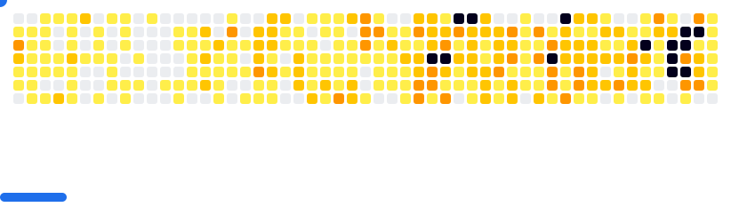

<h3><code>angel@github ~ $ whoami</code></h3>

<table>
<tr>
<td valign="top"></td>
<td valign="top"></td>
</tr>
</table>

**Fullstack Developer** · Next.js at work · NestJS, Angular and Flutter on my own products

I build and ship real software end to end: a personal finance app live on Google Play and a distributed AI video-surveillance platform. Still finishing my degree.

<h3><code>angel@github ~ $ ls projects/</code></h3>

**[Qipo](https://play.google.com/store/apps/details?id=com.angelloayza.qipo)** · *live on Google Play* · private repo 
Mobile-first personal finance app, built so logging an expense takes less than 10 seconds. 
`Flutter` `NestJS` `PostgreSQL` `Prisma` `Firebase Cloud Messaging` `Docker`

**Surveillance AI** · private repo 
Distributed platform for AI-powered security cameras: IP cameras stream frames, YOLO detects people and objects, and alerts are written in plain language. 
`NestJS microservices` `NATS` `Python` `YOLO` `PostgreSQL` `MinIO` `Kubernetes` `Prometheus` `Grafana`

**[DesktopGoose](https://github.com/angel452/DesktopGoose)** 
A pixel-art goose that lives on your macOS screen. 
`Swift` `AppKit`

<h3><code>angel@github ~ $ cat stack.txt</code></h3>

<h3><code>angel@github ~ $ ./links.sh</code></h3>

<h3><code>angel@github ~ $ ./breakout.sh</code></h3>

<picture>
  <source media="(prefers-color-scheme: dark)" srcset="images/breakout-dark.svg" />
  <source media="(prefers-color-scheme: light)" srcset="images/breakout-light.svg" />
  
</picture>
